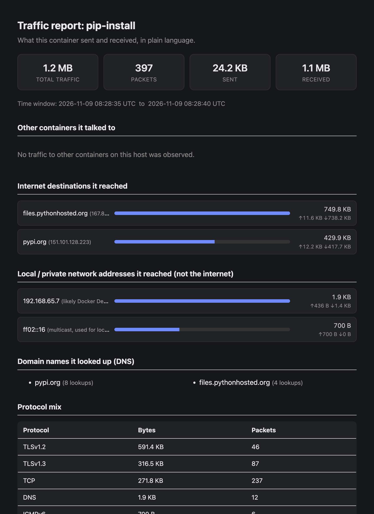

# nettap

[](https://github.com/danisherror/nettap/actions/workflows/ci.yml)

Attach traffic capture to one or many Docker containers, and analyze
docker-host, docker-docker, and docker-internet flows after the fact.

**What does this image talk to?** One command runs it inside a capture and
tells you, in plain language. Here, `pip install requests` in
`python:3.12-alpine` (a live run, recorded with `scripts/record_demo.sh`):


The same run as the self-contained HTML report it writes:



## Install

nettap runs as a Docker image, so the host needs nothing but Docker:

```
docker pull ghcr.io/danisherror/nettap
docker tag ghcr.io/danisherror/nettap nettap   # the short name used below
```

Or install the command line with `pip install nettap` (Python 3.9+). It
runs captures in that same image (the version matching the installed
package, pulled on first use), so tcpdump and tshark aren't needed on the
host. From a checkout: `docker build -t nettap .` and `pip install -e .`,
then set `NETTAP_IMAGE=nettap` so the CLI uses your build. Releases and
what changed in each are in `CHANGELOG.md`.

## How it sees the traffic

Every container gets its own network namespace wired to the host by a veth
pair (one end is the container's `eth0`, the other sits on the host attached
to a bridge). That host-side veth is the *only* door in or out of the
container, so capturing on it sees everything: traffic to the host, traffic
to other containers on the same bridge, and traffic out to the internet
(after NAT).

`nettap` resolves that host-side interface for a container without needing
anything installed inside the container image: it enters the container's
network namespace (via the netns file Docker already exposes under
`/var/run/docker/netns`) and asks the kernel over netlink (`ip -j -d link`)
which host interface is its veth peer. (Reading `/sys/class/net/eth0/iflink`
there doesn't work: sysfs still shows the host's interfaces under
`nsenter --net`, which is why `ip netns exec` remounts it.)

macvlan and ipvlan containers have no veth: their `eth0` hangs off a parent
interface that carries the whole host's traffic. `watch` captures those on
their own `eth0` from inside their namespace instead (`nsenter` + tcpdump).
Swarm overlay containers are similar: their veth's peer is in the overlay's
own namespace, and their internet traffic leaves through a second interface
on `docker_gwbridge`, so `watch` captures them inside their namespace on
every interface but `lo`. So are containers on more than one network.
Details and caveats are in `nettap/discovery.py`'s docstring.

## Architecture

```
 docker events / desired-state table          per-container tcpdump        tshark, every 5s    SQLite
 (controller.py + events.py, 5s poll)   --->   (capture.py)             --->  (ingest.py,     -> (storage.py)
        |                                              |                      enrich.py)               |
        v                                              v                                               v
  attach/detach requests from             raw pcaps, rotated every 60s                  analyze.py (JSON) /
  `nettap attach/detach` CLI calls        in data/pcap/, kept as-is                    report.py (plain English)
```

- **controller.py** - a small reconciliation loop: figure out which
  containers *should* be captured (label selector + ad-hoc attach requests),
  diff against what's currently captured, attach/detach the difference; also
  restarts any capture whose tcpdump process died on its own. Runs every
  5s, and right away when Docker reports a container start or death
  (events.py), so a new container is captured within a second or so.
- **capture.py** - runs one `tcpdump` per attached container against its
  resolved veth, rotating pcap files, plus a second one on the container's
  `lo` that only records lookups to Docker's embedded DNS server
  (`127.0.0.11`, which containers on user-defined networks - every Compose
  network included - use instead of going out over `eth0`; see
  [Docker's DNS docs](https://docs.docker.com/engine/network/#dns-services)).
  That one writes `<name>_<timestamp>.dns.pcap`; `watch` starts it inside
  the container's netns with `nsenter`. Relays tcpdump's own stderr into
  nettap's logging (so `docker logs <nettap container>` is actually useful
  for diagnosing a dead/misbehaving capture), and detects + restarts a
  tcpdump that exited unexpectedly (`restart_dead()`).
- **enrich.py** - parses a pcap with `tshark` into flow-level rows
  (5-tuple, byte length, DNS query and answers, TLS SNI, HTTP Host).
- **ingest.py** - every 5s, feeds enrich.py the packets each capture has
  written since the last pass, including the file tcpdump still has open
  (it flushes every packet), so traffic shows up in `analyze` within a few
  seconds instead of after a 60s rotation. How far each file has been read
  is stored with its rows, so nothing is counted twice. Runs on a
  background thread with its own SQLite connection (a shared connection
  across threads is a real bug we hit and fixed - see TODO.md).
- **storage.py** - SQLite: container metadata, flow rows, and the shared
  "desired state" / "live sessions" tables that let `nettap attach` from one
  terminal steer the `nettap watch` daemon running in another.
- **analyze.py** - read-side queries, JSON output: top talkers,
  container-to-container traffic matrix, DNS lookups, protocol mix, and
  traffic that left the Docker network entirely.
- **report.py** - the same data as `analyze`, rendered as a plain-language
  summary (terminal text or a self-contained HTML file) for someone who
  doesn't know what a pcap or a 5-tuple is.

## Quick start

**What does this image contact?** One command runs an image, captures it
from its first packet and writes the report:

```
docker run --rm -v /var/run/docker.sock:/var/run/docker.sock \
  -v "$(pwd)/data:/data" nettap inspect nginx:alpine --duration 2m
```

(with `pip install nettap`: `nettap inspect nginx:alpine --duration 2m`)

See [`nettap inspect`](#what-does-this-image-do-nettap-inspect) below. The
rest of this section captures a container you already run.

This uses **sidecar mode**, which works the same on Linux, Mac and Windows
(Docker Desktop). The nettap container joins one target container's network
(`--network container:<target>`) and captures its `eth0`. It needs no host
networking and no docker.sock.

```
mkdir -p data

# a container to watch - this one fetches a web page every 5 seconds
docker run -d --name web alpine \
  sh -c 'while true; do wget -qO /dev/null https://example.com; sleep 5; done'

# the sidecar: shares web's network and records everything it sends and receives
docker run -d --name nettap-web \
  --network container:web \
  --cap-add NET_ADMIN --cap-add NET_RAW \
  -v "$(pwd)/data:/data" \
  nettap sidecar --target web

# traffic shows up within about 10 seconds:
docker exec nettap-web nettap --data-dir /data report --container web
```

The report lists what `web` talked to: `example.com` (from DNS and the TLS
SNI), how many bytes went each way, and the protocols used. To watch your
own container instead, start it first, then start the sidecar with
`--network container:<name>` and `--target <name>`. One sidecar watches one
container; run one per container you care about.

Tear down when done:

```
docker rm -f nettap-web web
```

### Plain-language reports (for non-technical readers)

`analyze` prints raw JSON meant for scripting; add `--format table` to any
`analyze` subcommand for an aligned table that's easier to scan in a
terminal (byte counts human-readable, long values cut short). For a summary a non-technical
person can read - "sent 12MB, mostly to example.com, no traffic to other
containers" instead of rows of IPs and byte counts - use `report` instead:

```
# printed straight to your terminal
docker exec nettap-web nettap --data-dir /data report --container web

# a single HTML file you can double-click open in a browser - written into
# the bind-mounted data dir, so it lands on your host machine too
docker exec nettap-web nettap --data-dir /data report --container web --format html
```

The HTML version shows total traffic, who it talked to (other containers vs.
the internet, with hostnames from TLS SNI, HTTP Host or DNS answers where seen), DNS
lookups, and the protocol mix - as a self-contained file with no server or
internet connection needed to view it.

The `analyze` subcommands give the same data as JSON or tables:

```
docker exec nettap-web nettap --data-dir /data status
docker exec nettap-web nettap --data-dir /data analyze top-talkers --container web
docker exec nettap-web nettap --data-dir /data analyze external   # --scope internet hides private/Docker-internal addresses; --container X counts one container
docker exec nettap-web nettap --data-dir /data analyze dns --container web
```

`examples/sample_queries.md` walks through the same commands in `watch` mode,
with several containers.

### What does this image do? `nettap inspect`

```
docker run --rm -v /var/run/docker.sock:/var/run/docker.sock \
  -v "$(pwd)/data:/data" nettap inspect <image> [--duration 5m] [-- <command> <args>]
```

runs the image for `--duration` (default 60s, sooner if it exits), then
prints the text report and writes `data/<run>_report.html`. The run is
named `<image>-<date>-<time>` unless you pass `--name`; use that name with
`report`, `check`, `export` and `--compare`. Images often phone home, pull
config or resolve names the moment they start, so the capture starts
first: nettap starts a sidecar in a network of its own, waits until tcpdump
is listening, then runs the image inside that network (`--network
container:<sidecar>`, like containers in a Kubernetes pod). The image still
sees a normal network, with DNS. `-e KEY=VALUE`, `-p 8080:80`,
`--entrypoint` and `--network` work as for `docker run`. Parsing and the
report run in throwaway nettap containers, so the host needs nothing but
Docker. Run from the host (`pip install nettap`), it uses
`ghcr.io/danisherror/nettap:<installed version>`, pulled if needed;
`NETTAP_IMAGE` or `--nettap-image` picks another (e.g. `nettap`, built from
a checkout). Every container it
creates is removed afterwards, also on Ctrl+C (which ends the run early and
still writes the report).

### Allowlist checks in CI: `nettap check`

```
nettap check --container web --allow allowlist.txt
```

exits 0 if every destination `web` connected to is on the allowlist, 1
(listing the others) if not, and 2 if it can't tell (no traffic captured,
bad allowlist). The allowlist has one entry per line:

```
db                  # a container name
api.stripe.com      # a hostname, from the TLS SNI, HTTP Host or a DNS answer
*.amazonaws.com     # any subdomain (not amazonaws.com itself)
10.0.0.0/8          # an address or CIDR range
```

`--allow-entry` adds entries on the command line. Loopback (so Docker's DNS
server at 127.0.0.11), multicast and link-local addresses are always
allowed. A DNS server elsewhere isn't, e.g. Docker Desktop's at
192.168.65.7 on the default bridge network: allow it, or use a
user-defined network. Peers that connected *to* the container aren't
checked unless you pass `--direction all`. Hostnames come from the
container's own traffic, and a hostile program can send any SNI, so this
catches unplanned dependencies. It isn't a security boundary. With
`inspect`:

```
nettap inspect myapp:1.4 --name myapp-ci && \
  nettap check --container myapp-ci --allow allowlist.txt
```

### What changed? `report --compare`

```
nettap inspect myapp:1.4 --compare myapp-1.3-run     # an earlier inspect run
nettap report --container web --compare web-staging  # two captures
nettap report --container web --baseline-until 2026-11-09T14:00 --since 2026-11-09T14:00
```

adds a "What changed" section at the top of the report (text and HTML):
destinations, containers and DNS names that are new, ones no longer
contacted, and destinations whose traffic grew or shrank at least 2x and
by at least 10 KB. The last form compares one container before and after
an upgrade at 14:00. Internet destinations are matched by hostname, so a
CDN address change isn't a change. Bytes aren't adjusted for how long each
capture ran. `--since`/`--until` (`15m`, `2h`, `2026-11-09T14:00` in local
time, or Unix seconds) also work without `--compare`, to report on a time
range.

### Sharing results: `nettap export`

```
nettap export --container web --format json --since 1h > web.json
nettap export --container web --format csv --out web.csv
nettap export --container web --format pcap --since 2026-11-09T14:00
```

`json`/`csv` write the parsed flow rows. `pcap` merges the container's
capture files (its interface and DNS captures) in time order into one file
for Wireshark, at `data/web_export.pcap` by default. It's pcapng instead if
the captures mix link types. Packets whose pcaps retention already deleted
aren't in a pcap export (it says how many flow rows that affects); their
flow rows still are in JSON/CSV.

### Naming other containers in a sidecar's report

A sidecar only knows its own target's IPs, so a peer container without a
sidecar of its own shows up as a bare private IP. Add `--docker-api` and
mount the Docker socket to have the sidecar look up the other containers'
names and IPs (re-read every 30s):

```
docker run -d --name nettap-web \
  --network container:web \
  --cap-add NET_ADMIN --cap-add NET_RAW \
  -v "$(pwd)/data:/data" -v /var/run/docker.sock:/var/run/docker.sock \
  nettap sidecar --target web --docker-api
```

The socket gives the sidecar full control of Docker, so only mount it where
that's acceptable.

Raw pcaps land in `./data/pcap/` on the host either way (bind-mounted), so
`wireshark ./data/pcap/web_*.pcap` works for a deep dive regardless of which
capture mode produced them.

Raw pcaps are deleted after **24 hours**, or sooner, oldest first, once
`data/pcap/` holds more than **1 GB**. Flows already parsed into
`nettap.db` are kept, so reports still cover the whole capture. Change the
limits with `--pcap-max-age-hours` / `--pcap-max-size-mb` on `watch`,
`sidecar` or `sidecars` (`0` turns a limit off). The limits are logged at
startup and every deletion is logged; deleting a pcap that hasn't been
parsed yet (only likely with a very small size cap or `--no-auto-enrich`)
is logged as a warning.

### Sidecars that look after themselves: `nettap sidecars`

A plain sidecar exits when its target stops, and has to be started again
by hand (or recreated, if the target was recreated - see Troubleshooting).
`nettap sidecars` does that for you: one supervisor container, given the
Docker socket, starts a sidecar for every running container with a label,
and keeps them going:

```
docker run -d --name nettap-sidecars \
  -v /var/run/docker.sock:/var/run/docker.sock \
  -v "$(pwd)/data:/data" \
  nettap sidecars --label monitor=true

docker run -d --name web --label monitor=true nginx:alpine
```

Each sidecar is named `nettap-sidecar-<target>` and uses the supervisor's
own image and data mount, so reports work as above (`docker exec
nettap-sidecars nettap --data-dir /data report --container web`). Every 5s
(`--poll-interval`), and right away when Docker reports a container start
or death, the supervisor:

- starts a sidecar for each new labelled container,
- starts a sidecar again once its target is running again after a `docker
  stop`/`start` or `docker restart`,
- replaces the sidecar when the target is removed and recreated under the
  same name, and removes it when the target is gone for good.

A sidecar that exits for another reason (a crash, or you ran `docker stop`
on it) is left alone until its target restarts, and logged once. Stopping
the supervisor stops and removes its sidecars (`--keep-sidecars` leaves
them). `--rotate-seconds`, `--pcap-max-age-hours`, `--pcap-max-size-mb` and
`--docker-api` are passed on to every sidecar. Containers using `--network
host` or `--network container:...` are skipped. As with `--docker-api`, the
socket gives the supervisor full control of Docker.

### `watch` mode: every labelled container (Linux only, not yet verified)

`watch` is a single daemon that captures every container with a given label
(or all of them), attaching to new ones as they start. It needs a **Linux
host**, and it has not yet been run end-to-end on one (see `TODO.md`,
Stage 1). Prefer sidecar mode until that's done.

```
docker compose up -d --build
docker run -d --name web --label monitor=true nginx
```

By default the daemon watches for containers labeled `monitor=true` and
attaches as soon as Docker reports the container's start (the 5s poll is a
fallback). `nettap attach`/`detach` take effect within one poll cycle. To add or remove specific containers
instead of using a label:

```
docker compose exec nettap nettap --data-dir /data attach web db
docker compose exec nettap nettap --data-dir /data detach web
docker compose exec nettap nettap --data-dir /data status
```

`watch` runs the nettap container with `network_mode: host` so it can see
*other* containers' host-side veth interfaces. On Docker Desktop for
Mac/Windows that's an experimental, known-buggy feature (see
[docker/for-mac#7261](https://github.com/docker/for-mac/issues/7261)): it
can silently fail to see the host network, even when enabled. Use sidecar
mode there.

### Running without Docker Compose

```
pip install -e .
sudo nettap --data-dir ./data watch --label monitor=true
```

(needs `tcpdump`, `tshark`, `nsenter` on PATH, and root or the
`NET_ADMIN`/`NET_RAW`/`SYS_ADMIN` capabilities)

## Troubleshooting

**nettap exits right away with a one-line `Error: ...`.** It checks for
common setup mistakes at startup and says how to fix each one: a missing
capability (`NET_RAW` for tcpdump, plus `SYS_ADMIN` for `watch`), no
`/var/run/docker.sock` when Docker access is needed (`watch`, `sidecars`,
`sidecar --docker-api`), a data directory it can't write to (e.g. mounted
`:ro`), missing `tcpdump`/`tshark`, or a target that isn't there (`sidecar`
finds no `eth0`; `attach` is given a name no container has - pass
`--allow-missing` to queue a container you're about to create). All of
these exit with status 1.

**`report`/`analyze` says "no traffic" for a container you know is running.**
`--container` is matched against whatever string was passed to `sidecar
--target` (or the container's `name` as seen by `watch`'s Docker API calls)
- it is *not* looked up from `docker ps`. If you recreated the target
container since starting capture, its `docker ps` name may have changed
(Docker invents a new random `adjective_scientist` name for any container
started without `--name`) while nettap is still tagging data under the old
one. `report`/`analyze top-talkers`/`dns`/`protocols` now print the list of
container names that actually have data when the one you asked for doesn't
match, e.g. `containers with captured data so far: relaxed_panini`.

**A `sidecar` exits when its target container stops or is removed.**
(`nettap sidecars`, above, handles all of this automatically.)
`--network container:<target>` joins the target's network namespace once, at
start. When the target stops, Docker removes that shared `eth0`, and the
sidecar exits (code 3) with an `eth0 disappeared` error in `docker logs`.
A restart policy doesn't help: Docker tries once while the target is still
down, fails with "cannot join network namespace of a non running container",
and gives up. Once the target is running again:
```
docker start nettap-<target>
```
If the target was removed and recreated (even under the same name), the old
sidecar points at a container that no longer exists - recreate it too:
```
docker rm nettap-<target>
docker run -d --name nettap-<target> --network container:<target> \
  --cap-add NET_ADMIN --cap-add NET_RAW -v "$(pwd)/data:/data" \
  nettap sidecar --target <target>
```

**A `sidecar` refuses to start: "the target seems to use --network host".**
A `--network host` container has no network namespace of its own - it uses
the Docker host's - so a sidecar joined to it would capture every
container's traffic (it leaves through the host) and the host's own, all
labelled as the target. The sidecar spots this from Docker's bridge
interfaces (`docker0`, `br-...`), which only exist in the host's namespace,
and exits with code 1. To capture such a container, also join its process
namespace and pass `--attribute-by-port`:
```
docker run -d --name nettap-<target> --network container:<target> \
  --pid container:<target> --cap-add NET_ADMIN --cap-add NET_RAW \
  --cap-add SYS_PTRACE -v "$(pwd)/data:/data" \
  nettap sidecar --target <target> --attribute-by-port
```
The sidecar then samples which TCP/UDP ports the target's processes hold
(4 times a second) and keeps only the host's traffic on those ports.
`SYS_PTRACE` is needed to read the sockets of processes running as another
user (e.g. nginx's workers). Measured with `scripts/hostports_accuracy.sh`
(2026-11-09, Docker Desktop for Mac): connections to a listening port in
the target 100% (200/200), outgoing connections held open 0.5s 100%
(40/40), and short outgoing requests (one `wget` each, a few milliseconds
long) **0%** (0/200). So a host-network target's servers are covered, but
its quick outgoing requests and DNS lookups are not. ICMP isn't attributed, and only
`eth0` is captured, so traffic with other containers on the same host isn't
seen. `--allow-host-network` instead captures everything, labelled as the
target - e.g. for a Docker-in-Docker target, which has bridges of its own.

**`watch` logs "uses --network host and its sockets can't be attributed
to it".** `watch` captures `--network host` containers on the host's
internet-facing interface (the one `ip route get 1.1.1.1` names) and keeps
the traffic on ports the container's sockets held, with the same limits as
above. It finds those sockets with `ss --cgroup`, which needs nettap in the
host's cgroup namespace: `cgroup: host` in `docker-compose.yml` (already
set), or `--cgroupns host` with `docker run`. Run directly on the host
(`sudo nettap watch`), nothing extra is needed. Needs cgroup v2.

**Output seems frozen after the first report, even with new traffic.**
As of this build this should self-heal (a background thread used to die
silently on its first real write due to a cross-thread SQLite bug, and a
crashed tcpdump was never restarted - both fixed, see TODO.md). If you're
running an image built before that fix, `docker build -t nettap .` again and
recreate the container. Otherwise: new traffic should show up within about
10 seconds (packets are parsed every 5s, the newest 2s held back);
`nettap enrich` parses whatever is left in files no capture is writing any
more. Check `docker exec <nettap container> ls -la /data/pcap/` to confirm
new files are actually appearing and growing; check `docker logs <nettap
container>` for `tcpdump[...]:` lines, which now surface tcpdump's own
errors instead of going nowhere.

## Why the tool container needs `network_mode: host` + a few capabilities

Other containers' host-side veth interfaces live in the host's root network
namespace. A normally-networked container can't see them, so `nettap`'s own
container needs `network_mode: host`. It does **not** need `--privileged` or
`--pid=host`: `NET_ADMIN` + `NET_RAW` (for tcpdump) and `SYS_ADMIN` (to enter
another container's netns via `nsenter --net=<sandbox-key>`) are enough.

`/var/run/docker/netns` is mounted with `rslave` propagation. With Docker's
default (`rprivate`), nettap only sees the namespaces of containers that
were already running when it started; for later ones `nsenter` fails with
"Invalid argument" (seen 2026-11-08). Docker Desktop doesn't support mount
propagation ([docs](https://docs.docker.com/engine/storage/bind-mounts/#configure-bind-propagation))
and refuses to start the compose file - use `sidecar` there.

This is real privilege - only run it in environments you trust.

## Development

```
pip install -e ".[dev]"
pytest
```

Tests use mocked Docker/tcpdump/tshark calls (no real Docker daemon
required) and cover the veth-resolution logic, storage layer, capture
lifecycle (including the dead-process restart path), the `analyze`/`report`
queries, parsing a pcap in pieces while it grows, and a real-threading
regression test for the background enrich loop's SQLite usage. Two tests
run the real `tshark` and are skipped if it isn't installed.

`tests/live/` checks `discovery.resolve_capture()` against real containers
(user-defined and default bridge, macvlan, ipvlan, a container on two
networks), comparing its answer with what each container sees in its own
sysfs. It creates containers named `nettap-live-*`, needs root on a Linux
Docker host, and is left out of a plain `pytest` run:

```
sudo "$(which python)" -m pytest -m live tests/live
```

On Docker Desktop, run it inside `docker:dind` (as below, plus
`apk add python3 py3-pip iproute2 util-linux` and
`pip install --break-system-packages -e ".[dev]"`).

`scripts/integration_test.sh` is an end-to-end check against a real Docker
daemon: it starts a throwaway nginx server and alpine client, captures both,
sends HTTP between them and HTTPS to example.com, then checks the flow store
(container IPs, HTTP in both captures, the container matrix, internet
destinations and SNI, and the report). `--mode sidecar` (the default) puts a
sidecar on each container; `--mode watch` runs one host-networked `nettap
watch` set up like `docker-compose.yml`, which picks up the server by label
and the client via `nettap attach`; `--mode sidecars` runs `nettap sidecars`
and, before the traffic checks, restarts the server and then recreates it,
checking each time that a sidecar is capturing it again with no manual step.
Every mode also checks that the HTTP traffic reaches the flow store within
15 seconds of being sent, before `nettap enrich` is run. Pass `--no-internet` to skip the
internet part, `--keep` to keep the data dir. Everything it creates is named
`nettap-it-*` and removed on exit.

Every mode then runs `nettap check` on the client against an allowlist that
names the server but not a third container the client also called
(`nettap-it-*-other`), and expects exit 1 listing only that one, then exit
0 once it is allowed.

`scripts/hostports_accuracy.sh` measures `sidecar --attribute-by-port` for
a `--network host` target: the share of short outgoing requests, outgoing
connections held 0.5s, and connections to a listening port that end up in
the target's flows. It fails if fewer than 95% of the incoming ones are
caught (`-n` sets the number of connections, default 100). Containers are
named `nettap-acc-*`.

`--mode watch` needs a Linux Docker daemon. On Docker Desktop you can get one
with Docker-in-Docker:

```
docker run -d --privileged --name nettap-it-dind docker:dind
docker exec nettap-it-dind apk add bash
docker exec nettap-it-dind mkdir /src
tar --exclude .git --exclude data -cf - . | docker exec -i nettap-it-dind tar -xf - -C /src
docker exec nettap-it-dind bash /src/scripts/integration_test.sh --mode watch
docker rm -f -v nettap-it-dind
```

That runs a normal Linux `dockerd`, but on Docker Desktop's VM kernel, so it
doesn't replace a test on a real Linux host (see TODO.md).

CI (`.github/workflows/ci.yml`) runs on every push and pull request on
GitHub's Ubuntu runners, which are real Linux hosts: `pytest` on Python 3.9
and the newest release (with `tshark` installed, so the real-tshark test
runs), the `tests/live/` suite as root, and `integration_test.sh
--no-internet` in `sidecar`, `watch` and `sidecars` mode,
`hostports_accuracy.sh`, and a package build (`python -m build`, `twine
check`, then `nettap --version` from the installed wheel).

`scripts/record_demo.sh` re-records the demo at the top of this README
from a live `nettap inspect` run (needs asciinema 2.x and Chrome for the
screenshot); `scripts/cast2svg.py` turns the recording into the animated
SVG.

### Releasing

Versions follow [semver](https://semver.org/) and live in one place,
`nettap/__init__.py` (`pyproject.toml` reads it from there). To release
X.Y.Z:

1. Set `__version__ = "X.Y.Z"`, and in `CHANGELOG.md` replace
   `Unreleased` in its section heading with today's date (YYYY-MM-DD).
   Commit and merge to `master`.
2. Tag and push: `git tag -a vX.Y.Z -m "nettap X.Y.Z" && git push origin vX.Y.Z`.

`.github/workflows/release.yml` then checks that the tag, version and
changelog agree (`scripts/release_notes.py`), runs the tests, publishes the
package to PyPI and a `linux/amd64` + `linux/arm64` image to
`ghcr.io/danisherror/nettap` (tags `X.Y.Z`, `X.Y` and `latest`), and
creates a GitHub release with the changelog section as its notes.

One-time setup before the first release:

- PyPI: add a [trusted publisher](https://docs.pypi.org/trusted-publishers/adding-a-publisher/)
  for the project `nettap` (a "pending publisher" while the project doesn't
  exist yet): owner `danisherror`, repository `nettap`, workflow
  `release.yml`, environment `pypi`. No API token is stored in GitHub.
- GitHub: create the `pypi` environment (Settings -> Environments). After
  the first image push, make the `nettap` package public (Packages ->
  nettap -> Package settings), since new GHCR packages start private.

## Project layout

```
nettap/
  nettap/
    discovery.py   veth resolution (container -> host interface)
    capture.py     tcpdump process lifecycle per container
    controller.py  reconciliation loop (desired state -> attach/detach)
    enrich.py      pcap -> structured flow rows via tshark
    ingest.py      parse each pcap in pieces while tcpdump writes it
    events.py      Docker events stream -> wake the polling loops
    storage.py     SQLite schema + accessors
    analyze.py     read-side queries (JSON, or a table via --format table)
    report.py      read-side queries, rendered as plain language (text/HTML)
    supervisor.py  `nettap sidecars`: one self-healing sidecar per container
    inspector.py   `nettap inspect`: run an image inside a capture, then report
    check.py       `nettap check`: destinations vs. an allowlist
    compare.py     `report --compare`: what changed between two captures
    export.py      `nettap export`: flows as JSON/CSV, packets as one pcap
    preflight.py   startup checks with one-line fixes (caps, docker.sock, data dir)
    hostports.py   `--network host` targets: which ports they hold
    cli.py         `nettap` command line
  tests/           unit tests (mocked, no live Docker needed)
    live/          discovery tests against real containers (Linux, root)
  scripts/         integration_test.sh - end-to-end check on a live Docker host
                   hostports_accuracy.sh - host-network attribution, measured
                   release_notes.py - release tag/version/changelog check
                   record_demo.sh, cast2svg.py - the README demo
  docs/            architecture diagram, demo recording and screenshot
  examples/        sample CLI session
  Dockerfile, docker-compose.yml
  CHANGELOG.md     what changed in each release
  TODO.md          roadmap - read this before your next session
```

## Known limitations

- `--network host` containers have no interface of their own: they're
  captured on the host's internet-facing interface and kept to the ports
  they held (see Troubleshooting): incoming connections to its servers are
  all caught, but short outgoing requests are missed almost entirely (0%
  measured), as are ICMP and traffic with other containers on the same host.
- In `watch`, a container whose `eth0` is neither a veth nor macvlan/ipvlan
  is skipped with a warning.
- TLS/SSH traffic gives metadata (IPs, ports, byte counts, SNI) not
  plaintext payloads.
- Single Docker host only: overlay containers are captured, but flows aren't
  matched across two hosts' nettap instances.
- Raw pcaps are kept for 24h / up to 1 GB by default. The newest file of
  each capture is never deleted, so the cap can be exceeded by about one
  file per capture.
- The capability check only runs when nettap is root on Linux (the Docker
  setup); elsewhere a missing permission shows up as tcpdump's own error.
- External IPs are named from TLS SNI, HTTP Host headers and DNS answers.
  DNS answers on user-defined networks come from the extra capture on the
  container's `lo` (tested in `sidecar` mode, and in `watch` mode on
  Docker Desktop for Mac, not yet on a Linux host).
- A plain `sidecar` exits when its target stops; start it again afterwards,
  or recreate it if the target was recreated (see Troubleshooting above) -
  or let `nettap sidecars` do it.

See `TODO.md` for the full list, what's already been fixed, and what's next.

## License

MIT - see `LICENSE`.
